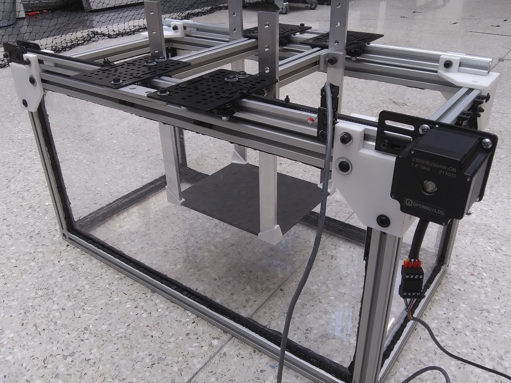

I'm building a tabletop device for generating sand dunes and studying their dynamics.
This build is still in progress, so check back for updates!

The design is based on Pascal Hersen's tabletop dune generator from his PhD work with Stéphane Douady in the early 2000s.
It uses a stepper motor and timing belt to drive a plate back and forth in a water-filled tank.
The plate has a rough top surface, and sand (or other grains) are initially deposited on the rough plate.
With the appropriate experimental conditions (e.g., grain density, plate depth and velocity profile), the pile of sand evolves, over less than an hour, into a barchan dune (a crescent-shaped dune found in nature).
